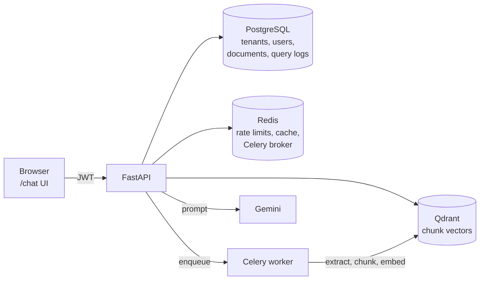
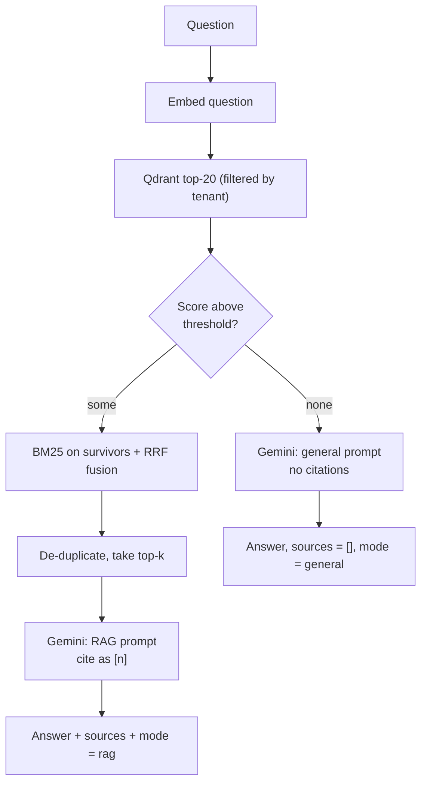

<div align="center">

# NexaRAG

**Multi-tenant document Q&A API with hybrid retrieval, cited answers, streaming and multi-document comparison.**

[](https://github.com/Akleshsoni/NexaRAG/actions/workflows/ci.yml)


</div>

Upload PDF/DOCX files, ask questions in English, Hindi or Hinglish, and get answers grounded in **your own documents**
with numbered source citations. Every tenant's data is isolated at the database *and* vector-store level.
If a question has nothing to do with your documents, it is answered as a normal AI question instead of forcing a
bad citation.

> **Status:** a working portfolio project, developed and run locally with Docker Compose.
> No accuracy or performance numbers are claimed in this README. Run the [evaluation](#evaluation) and
> [load-test](#load-testing) scripts yourself and use what they print.

## Contents
[Features](#features) · [How it works](#how-it-works) · [Quick start](#quick-start) · [Try the API](#try-the-api) ·
[API reference](#api-reference) · [Design decisions](#design-decisions) · [Configuration](#configuration) ·
[Testing](#testing) · [Evaluation](#evaluation) · [Load testing](#load-testing) · [Limitations](#known-limitations) ·
[Roadmap](#roadmap) · [Project layout](#project-layout)

## Features

| Area | What you get |
|---|---|
| **Auth & tenancy** | Signup/login with JWT. Each tenant only ever sees its own documents, vectors and history. |
| **Documents** | Upload PDF/DOCX (max 10 MB, file-signature check), paginated list, delete, re-index. Background processing: `pending → processing → ready \| failed`. |
| **Hybrid retrieval** | Local dense embeddings (`bge-small-en-v1.5`) + BM25 keyword scoring, merged with Reciprocal Rank Fusion, near-duplicate removal. |
| **Smart routing** | Chunks under a similarity threshold are dropped. Nothing left → general AI answer (`mode: "general"`). Otherwise → document RAG with citations (`mode: "rag"`). |
| **Answers** | Normal JSON endpoint and token-by-token **streaming (SSE)** with cancel. Sources show filename and similarity score. |
| **Comparison** | Compare 2–5 documents; retrieval runs per document, and the answer says which document each point came from. |
| **Suggestions** | 5 starter questions generated from the document's own indexed text. |
| **Languages** | Ask in English, Hindi or Hinglish; the model answers in your language. |
| **Insight** | Query history and a stats dashboard (documents, queries, latency, tokens). |
| **Operations** | Per-user rate limits, `/health` with dependency checks, JSON logs, Alembic migrations, GitHub Actions CI. |

<!-- Add screenshots here once you have them:


-->

## How it works



**Ingestion.** Upload → file validated and stored → Celery worker extracts text → splits into 400-token chunks
(60 overlap) → embeds locally with fastembed → writes vectors to Qdrant tagged with `tenant_id` and `document_id`.

**Query.**



The similarity score on each source is the **retrieval** cosine similarity of that passage, not the model's confidence
in its answer.

## Quick start

**Requirements:** Docker Desktop and a free [Gemini API key](https://aistudio.google.com/apikey).

```bash
git clone https://github.com/Akleshsoni/NexaRAG.git
cd NexaRAG
cp .env.example .env          # Windows CMD: copy .env.example .env
```

Edit `.env`: set `GEMINI_API_KEY` and a strong `SECRET_KEY`
(`python -c "import secrets; print(secrets.token_urlsafe(48))"`). Then:

```bash
docker compose up --build
```

The first build takes a few minutes because the embedding model is baked into the image.
Migrations run automatically. When `http://localhost:8080/health` shows `"status": "ok"`:

1. Open **http://localhost:8080/chat** and sign up.
2. Upload a PDF and wait until it shows *ready*.
3. Ask a question about it, then ask something unrelated (e.g. "What is Python?") and compare the two answers.

Interactive API docs: **http://localhost:8080/docs**

## Try the API

```bash
BASE=http://localhost:8080

# sign up and keep the token
TOKEN=$(curl -s -X POST $BASE/auth/signup -H "Content-Type: application/json" \
  -d '{"email":"me@example.com","password":"a-strong-password","tenant_name":"Demo"}' | python -c "import sys,json; print(json.load(sys.stdin)['access_token'])")

# upload a document, then check its status
curl -s -X POST $BASE/documents -H "Authorization: Bearer $TOKEN" -F "file=@eval/sample_docs/cs_notes.pdf"
curl -s "$BASE/documents?page=1&limit=10" -H "Authorization: Bearer $TOKEN"

# ask a question
curl -s -X POST $BASE/query -H "Authorization: Bearer $TOKEN" -H "Content-Type: application/json" \
  -d '{"question":"What principle does a stack follow?"}'

# stream the answer (SSE)
curl -N -X POST $BASE/query/stream -H "Authorization: Bearer $TOKEN" -H "Content-Type: application/json" \
  -d '{"question":"What principle does a stack follow?"}'
```

Response shape of `/query`:

```json
{
  "answer": "… cited as [1] …",
  "mode": "rag",
  "latency_ms": 0,
  "sources": [
    { "chunk_id": "…", "document_id": "…", "filename": "cs_notes.pdf", "text": "…", "score": 0.0 }
  ]
}
```

(`mode` is `"general"` with `sources: []` when nothing relevant was retrieved. Values above are placeholders.)

**Comparing documents** — send 2–5 of your document IDs:

```bash
curl -s -X POST $BASE/query/compare -H "Authorization: Bearer $TOKEN" -H "Content-Type: application/json" \
  -d '{"question":"What do these documents have in common and how do they differ?","document_ids":["<id-1>","<id-2>"]}'
```

The response contains the comparison `answer`, `documents_compared` (with how many chunks each document contributed)
and the numbered `sources`. A document with no relevant content is reported as such rather than guessed about.

## API reference

| Method | Path | Purpose |
|---|---|---|
| POST | `/auth/signup`, `/auth/login` | Get a JWT |
| POST | `/documents` | Upload PDF/DOCX |
| GET | `/documents?page=&limit=` | Paginated list |
| DELETE | `/documents/{id}` | Delete document, vectors and file |
| POST | `/documents/{id}/reindex` | Re-process the stored file |
| GET | `/documents/{id}/suggestions` | 5 questions from the document |
| POST | `/query` | Answer, sources and `mode` |
| POST | `/query/stream` | SSE events: `mode`, `token`…, then `done` (sources) or `error` |
| POST | `/query/compare` | Compare 2–5 documents |
| GET | `/queries?page=&limit=` | Query history |
| GET | `/stats` | Documents, queries, average latency, tokens |
| GET | `/health` | API, PostgreSQL, Redis, Qdrant status |

Paginated responses use `{items, total, page, limit, total_pages}`. Errors are `{"detail": "..."}` with a meaningful
status: `401` auth, `404` not found, `409` wrong state, `413` too large, `429` rate limit, `502` LLM failure,
`503` dependency down. Internal errors, stack traces and secrets are never returned.

## Design decisions

| Decision | Why |
|---|---|
| **Hybrid search (vector + BM25 + RRF)** | Embeddings capture meaning but can miss exact terms such as names, codes or `O(V+E)`; BM25 catches those. RRF merges the two rankings without having to normalise incompatible scores. |
| **Local embeddings (fastembed)** | No API key, no rate limits, no per-call cost; ONNX keeps the image small (no PyTorch). Trade-off: an English-only model. |
| **Threshold routing to general AI** | Avoids forcing irrelevant citations onto general questions. It is a retrieval-confidence heuristic, not an intent classifier — tune it with the evaluation script. |
| **Tenant filter in the vector query** | Isolation is enforced where the data lives, not only in application code. The tenant condition is always present; document filters only narrow it. |
| **Celery for ingestion** | Parsing and embedding are slow and must not block requests. The worker re-checks the document before and after writing vectors, so a document deleted mid-processing never leaves orphan vectors. |
| **Cache with per-tenant version** | Answers are cached for 30 minutes; delete, re-index and finished processing bump the tenant's version, so stale answers can't outlive their sources. |
| **404 instead of 403 across tenants** | Another tenant's document ID looks exactly like a missing one — existence isn't leaked. |

## Configuration

Copy `.env.example` to `.env` (never commit `.env`). The ones you are most likely to change:

| Variable | Default | Meaning |
|---|---|---|
| `GEMINI_API_KEY` | – | Required for answers, comparison and suggestions |
| `SECRET_KEY` | `dev-secret` | JWT signing key. The app refuses to start outside `ENVIRONMENT=development` with the default |
| `RETRIEVAL_MIN_SCORE` | `0.55` | Similarity threshold for RAG vs general routing — a starting guess, tune it |
| `MAX_UPLOAD_MB` | `10` | Upload size limit |
| `RATE_LIMIT_QUERY_RPM` | `30` | Per-user limits per minute; also `_DEFAULT_`, `_UPLOAD_`, `_SUGGESTIONS_` |

## Testing

```bash
pip install -r requirements.txt ruff
ruff check app tests eval locustfile.py
pytest tests/ -v          # unit + mocked route tests; no services needed

# integration tests against the running stack (needs a Gemini key):
NEXARAG_BASE_URL=http://localhost:8080 pytest tests/test_integration.py -v
```

*Unit and route tests* cover token validation (valid/expired/garbage), tenant-filter construction, upload validation,
pagination, threshold/dedup/fusion logic, RAG vs general routing, deleted-document handling, streaming events and
error mapping. *Integration tests* cover signup/login, tenant isolation, upload → ready → query → history → stats,
re-index, delete-then-not-queryable and rate limiting. CI runs lint and the unit tests on every push.

## Evaluation

```bash
# first upload eval/sample_docs/cs_notes.pdf to a dedicated account and wait for "ready"
docker compose exec api python eval/evaluate_rag.py --base-url http://localhost:8000 \
    --email you@example.com --password '...'      # add --judge for a Gemini faithfulness score
```

Measures **Hit@1/3/5**, **MRR**, false-abstain and abstention rates (does an unrelated question correctly skip the
documents?), answer keyword coverage, optional LLM-judged faithfulness and latency over 24 in-scope and 5
out-of-scope questions (`eval/rag_eval_set.json`).

*Limitations:* one small document; "relevant" means a retrieved chunk contains an evidence phrase; keyword coverage
cannot detect wrong reasoning; the LLM judge is itself an LLM. Use it to compare settings (e.g. different
`RETRIEVAL_MIN_SCORE` values), not as a general accuracy claim.

## Load testing

```bash
pip install locust
LOCUST_EMAIL=... LOCUST_PASSWORD=... locust -f locustfile.py --host http://localhost:8080 --headless -u 10 -r 2 -t 2m
```

Rate limits are per user and all simulated users share one account, so raise `RATE_LIMIT_*` in `.env` for a throughput
test or you will mostly measure `429`s. Record the numbers Locust prints.

## Known limitations

- Embeddings are English-only: Hindi/Hinglish questions are answered in-language but may retrieve poorly.
  A multilingual model needs a new vector size and a full re-index.
- The similarity threshold is a heuristic: a document question that retrieves weakly is answered as "general".
- `reranking.py` is a pass-through, not a cross-encoder.
- Query history is per tenant (all users of a tenant share it). "Failed queries" in stats is a Redis counter.
- Files live on a local volume (no object storage, no virus scanning). Gemini's free tier has low daily limits.
- The Docker setup is for local development (`--reload`, source mounts). The chat UI stores its JWT in `sessionStorage`.
- The Celery worker is not covered by `/health`.

## Roadmap

- Cross-encoder reranker and a multilingual embedding model
- Refresh tokens and per-user history
- Object storage for uploads, malware scanning
- Production compose profile (no reload, reverse proxy with TLS) and cloud deployment
- Worker health in `/health`, Prometheus metrics

## Project layout

```
app/api/routes/   auth, documents, query, history, stats, chat_ui
app/services/     retrieval, vectorstore, embeddings, llm, comparison, chunking, cache, reranking
app/workers/      celery_app, tasks (document processing)
app/core/         config, security, logging
migrations/       Alembic            tests/   pytest            eval/   evaluation set + scripts
```
